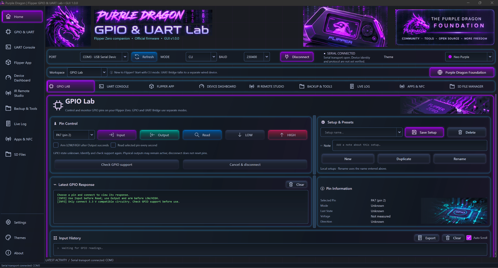

# PurpleDragonFlipperStudio

**Neon GUI v1.0.2 · Created by KyleAustinHillier @PurpleDragonFoundationLtd**

A native Qt desktop companion for Flipper Zero with a neon console interface, USB serial tools, digital GPIO Workbench, IR libraries, SD File Manager, verified backups and compatibility reporting.



*Current v1.0.2 desktop screenshot.*

[Downloads](https://github.com/bubblegump30/PurpleDragonFlipperStudio/releases) · [Quick start](docs/QUICKSTART.md) · [1.0.2 release notes](docs/RELEASE-v1.0.2.md) · [Release history](docs/CHANGELOG.md)

## Install

Download **Windows-x64.zip**, extract the whole archive into a new folder, and run **PurpleDragonFlipperStudio.exe**. Keep **_internal** beside the executable. No separate Python installation or administrator rights are required. The package includes README-FIRST.txt, release notes and dependency notices.

Source users: run **Setup.bat**, then **Start.bat**. Standard 64-bit CPython 3.10–3.14 is supported by setup; release CI uses Python 3.12. **Debug-Launch.bat** shows launch errors. Export a settings backup before upgrading and export IR libraries separately. Existing local settings are reused.

## Audit & polish — 1.0.2

Hardened local imports and corrupt-store recovery, made backup verification cancellation-aware, tightened SD responses and serial writes, and polished shutdown, reconnect and compact layouts. See the [audit report](docs/AUDIT-v1.0.2.md).

## Identity hotfix — 1.0.1

The identity parser now accepts the official 8-byte UID64 (16 hexadecimal digits), while retaining the prior 24-digit format. A complete unsupported identity reply keeps the serial console connected with hardware capabilities disabled; timeouts, oversized replies and transport failures still close the session.

## First connection

Use a USB data cable, close qFlipper or other serial tools, **Refresh → select port → CLI → Connect**. Open **Device Dashboard → Identify / Refresh device**, then run the support check in your chosen workspace. No hardware commands are sent automatically at startup or connection. Manual console sends invalidate device checks; identify and check support again.

## Features

| Workspace | Available in 1.0 |
| --- | --- |
| GPIO Lab | Eight regular header pins; input/read, confirmed Output starting LOW, armed LOW/HIGH, optional one-second input polling, bounded exportable history |
| IR Remote Studio | Validated .ir import, ten named local libraries, filtering, full-file/selected-signal export, explicit support check and confirmed single-command transmission |
| SD Files | /ext browsing, verified binary transfers up to 4 MiB, create-new uploads, folders and confirmed non-recursive deletion |
| Backup & Tools | Recursive SD backups with SHA-256 manifests, empty folders, verification/preview and confirmed restoration into a new SD folder; settings exports and diagnostics |
| UART Console | Explicit text sends, selectable line endings, saved favorites, history, transcript search, pause capture, timestamps and text/JSON export |
| Device Dashboard | Explicit identity query, per-session capability table, read-only local checks, recovery guidance and identifier-free compatibility report |
| Desktop | Nine workspace tabs, sidebar navigation, eight themes, window/panel memory, keyboard shortcuts, searchable F1 Help Center and configurable Matrix rain |

GPIO and IR do not require an SD card. Backups are limited to 4 MiB/file, 256 MiB total and 2,000 entries. IR libraries are limited to ten libraries and 2 MB total text. See the [quick start](docs/QUICKSTART.md) and [integration contracts](docs/INTEGRATION.md) for detailed limits.

## Compatibility and scope

The 1.0 desktop release consolidates tested software workflows. **Physical device and firmware compatibility remain unverified on hardware.** Adapter checks require device_info major 2, Flipper Zero target 7, documented CLI responses and an unprefixed `>:` prompt on its own line. Firmware version numbers alone never enable capabilities. This is a protocol check, not cryptographic authentication.

Disconnect/cancel does not reset GPIO outputs or undo commands already executed. IR completion does not verify appliance reception. Interrupted SD writes may leave partial new data. Reconnection is explicit; commands are never replayed automatically. App installation, battery telemetry, ADC, PWM and power switching are not implemented. This independent companion is not an official Flipper Devices product.

## Build, test and verify

```text
python -m unittest discover -s tests -v
Build-Windows.bat
python scripts/smoke_windows.py dist/PurpleDragonFlipperStudio/PurpleDragonFlipperStudio.exe
python scripts/package_release.py --windows dist/PurpleDragonFlipperStudio --output release-assets
python scripts/verify_release.py release-assets --require-windows
```

Packaging requires committed tracked changes. CI runs the tests, builds the executable, launches it with isolated settings to render a screenshot and exit, packages source/Windows ZIPs, and verifies archive hashes/layout/commit metadata before uploading the artifact. It does not publish a GitHub release automatically. See [release procedure](docs/GITHUB-UPLOAD.md).

The verifier checks consistency and integrity, not code signing or the trustworthiness of a downloaded manifest. Compare hashes against the trusted release. The source ZIP and Windows ZIP must come from the same workflow commit.

## Support and project

Press **F1** for the Help Center. For reports, export compatibility JSON from Device Dashboard or diagnostics from Backup & Tools. Review console/log exports before sharing because they may contain private information.

[Validation](docs/VALIDATION.md) · [Contributing](CONTRIBUTING.md) · [Security](SECURITY.md) · [MIT license](LICENSE) · [Dependency notices](docs/DEPENDENCIES.md)

[Purple Dragon Foundation](https://www.purpledragonfoundationltd.xyz/) · [GitHub](https://github.com/bubblegump30/PurpleDragonFlipperStudio)
